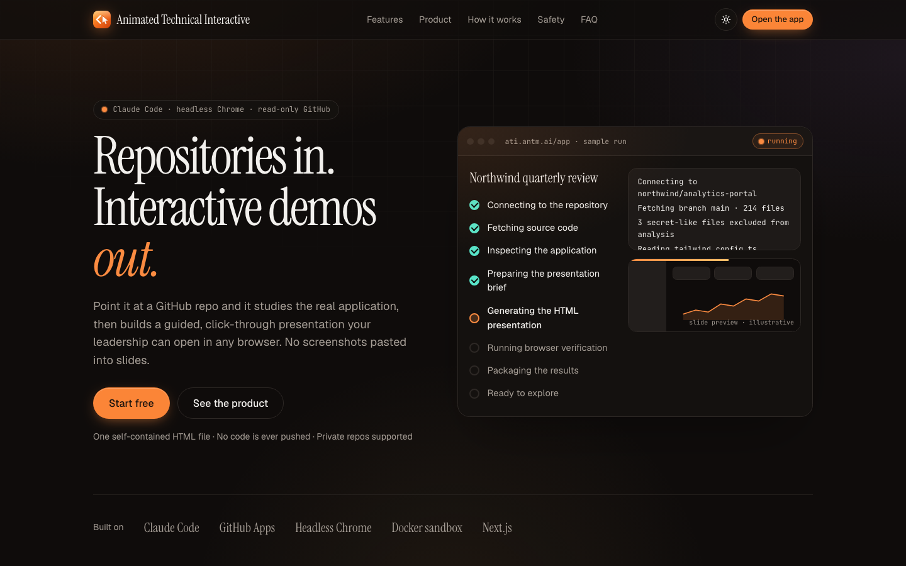
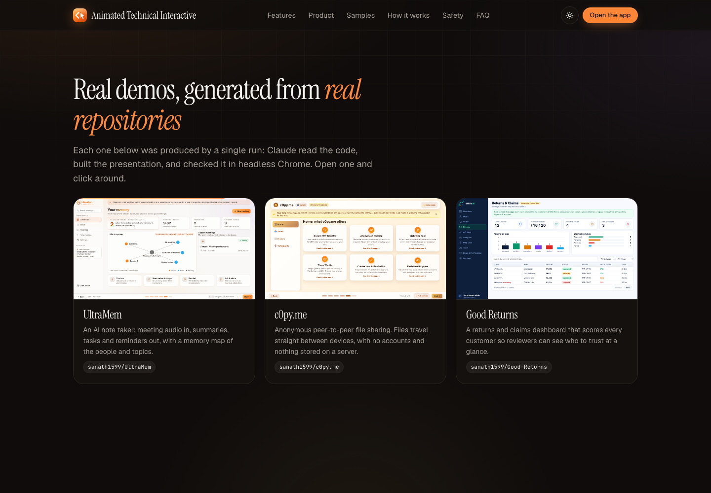

<div align="center">


# Animated Technical Interactive

**Turn any GitHub repository into a faithful, interactive executive demo.**

Claude Code reads the real code, rebuilds the real UI, and ships one self-contained HTML file, checked in headless Chrome.

[**Live app**](https://app.antm.ai) · [**Samples**](https://app.antm.ai/samples) · [**Blog: antm.ai**](https://antm.ai)



</div>

---

## What it does

Point it at a repository and a title. It studies the application, then produces a guided, click-through presentation your leadership can open in any browser, with no screenshots pasted into slides.

- **Replicates the real UI.** Colors, fonts, spacing, copy, icons and states are transcribed from the source, not approximated. Every recreated screen is traced to its source files.
- **Sized to the product.** No fixed slide count: a small app gets about six slides, a broad product gets as many as it needs.
- **Honest verification.** Each check is recorded as passed, failed or not run. Figures that can't be verified from the code are labelled illustrative.
- **Read-only.** A GitHub App with Contents and Metadata read access. Nothing is ever committed or pushed.
- **One file out.** A single self-contained `.html` with no external requests, previewed in a sandbox and downloadable.



See real outputs generated from real repositories on the [samples page](https://app.antm.ai/samples).

## How it works

```
Browser ──► Next.js (Node runtime, SQLite) ──► host clones the repo with a short-lived,
               │                                read-only GitHub App installation token
               │                                          │
               │   SSE (event ids + Last-Event-ID replay) ▼
               └◄──── events ◄── JSONL ◄── runner container (one per run): Claude Agent SDK,
                                            cwd = scrubbed repo copy, restricted tools,
                                            headless Chromium, no GitHub credentials
```

1. **Sign in** with GitHub (GitHub App user-to-server OAuth, sealed HttpOnly session cookie).
2. **Pick a repository** from those you installed the app on, public or private, user or organization.
3. **Configure:** a title is required; audience, details and sample data (CSV, JSON, text, Markdown, XLSX, images) are optional.
4. **Run:** the job is queued, the repo is cloned and scrubbed (secret files and escaping symlinks removed, `.git` deleted), and the agent runs in an isolated container while progress streams live.
5. **Result:** sandboxed preview, download, screenshots, a verification report and a data-sources and caveats report.

Progress stages advance only on real signals (first read, first write to the output folder, first headless-browser command), never on timers.

## Build in claude.ai on your own Claude plan

The same generator also runs as a **claude.ai artifact**, so each person's Claude usage comes from their own plan while this server does the heavy lifting:

```
claude.ai artifact (artifact/)  ── sample ──►  Claude, on the viewer's plan
        │
        └── mcp ──► "Animated Technical Interactive" connector = this server's /api/mcp (OAuth 2.1)
                       ├─ fetch: GitHub App, Azure DevOps / GitLab / Bitbucket (saved read-only tokens), or an uploaded zip
                       ├─ read_files / search_code on a scrubbed, read-only copy
                       ├─ save_deck: HTML, build state (resume and revise) and reports
                       └─ verify_deck: headless Chromium in the runner image, network off, screenshots back to the artifact
```

The artifact orchestrates the build: survey the files → plan the deck → transcribe the shared styles → rebuild each screen → render every slide and step in Chromium → have Claude review each screen against its screenshots and fix what differs → write the verification and evidence reports. The server never calls Claude in this mode.

**One-time setup (operator)**

1. Deploy as below, then rebuild the runner image (`npm run runner:build`): verification uses its Chromium and `puppeteer-core`.
2. Build the page: `node artifact/build.mjs https://app.antm.ai` writes `artifact/dist/index.html`.
3. Publish that file as a claude.ai artifact with the capabilities `sample` (with images), `downloads`, and `mcp` for the connector named **Animated Technical Interactive** (tools: `list_sources`, `list_branches`, `upload_archive`, `open_workspace`, `workspace_status`, `read_files`, `search_code`, `save_deck`, `verify_deck`, `get_deck`, `record_generation`, `record_usage`). Share it with your organisation.
4. Set `ARTIFACT_URL` to the artifact's link so the dashboard points people to it, and `ADMIN_LOGINS` to the GitHub logins that may see usage across all users.

**Per user: starts on the website**

1. **Sign in.** "Get started" on the landing page opens `/dashboard`, which signs in with GitHub (creating the account) and links to the GitHub App installation for choosing repositories.
2. **Add to Claude.** The dashboard's button opens claude.ai's *Add custom connector* dialog with the name and URL already filled in (`https://claude.ai/customize/connectors?modal=add-custom-connector&connectorName=…&connectorUrl=…`). The user clicks Add, then Connect; because they are already signed in here, the consent screen appears straight away. The dashboard polls and flips to *connected* as soon as claude.ai holds a grant. claude.ai has no "return to" parameter, so the user comes back to the dashboard tab themselves.
3. **Build.** "Open the builder" opens the artifact, which finds the connector by name and connects back to this server. Pick a repository (or upload a folder/zip), add a title, optional instructions and sample files (CSV/JSON/text, images, PDFs), and build.
4. For Azure DevOps, GitLab or Bitbucket, save a read-only token on the dashboard (Azure DevOps: Code Read; GitLab: read_repository; Bitbucket: repository read). Tokens are sealed on the server and never reach the artifact or Claude.

Organisation owners can instead add the connector once for everyone under Organisation settings → Connectors (the same link works on `claude.ai/admin-settings/connectors`).

**History and usage.** The artifact reports each build, resume and revision (`record_generation`) and every Claude call it makes (`record_usage`: step, model tier, prompt and answer sizes, images, duration, success). The dashboard shows the build history with previews, downloads and reports, plus usage over 7, 30 or 90 days: builds, success rate, Claude calls, estimated tokens per day and per step, and Claude time. Token counts are estimates (about four characters per token, about 1,300 tokens per screenshot) because Claude runs on the viewer's plan and the page cannot see billed amounts; claude.ai shows actual plan usage. Users in `ADMIN_LOGINS` can switch to *All users* for per-user totals. A build that stops reporting for 20 minutes (tab closed) shows as *interrupted*. Connector tool calls are logged for "last used" and kept for 180 days.

**Security notes.** The connector is an OAuth 2.1 authorization server with dynamic client registration, PKCE (S256), hashed opaque tokens, one-hour access tokens and rotating refresh tokens with reuse detection; consent requires a same-origin form post. Every workspace and deck is owner-scoped. Git hosts are allow-listed (`GIT_EXTRA_HOSTS` adds self-hosted servers); credentials are passed to git as a per-host header, never in argv or `.git/config`. Uploaded zips are extracted with path-traversal and size checks. Generated decks are rendered for verification in the runner container with `--network none`, and served back with a sandboxing CSP.

**Limits.** Quality depends on what fits in each Claude call (about 256 KB of input), so very large frontends are read selectively. claude.ai allows a few calls at once per viewer, so a build takes 15-40 minutes and the tab must stay open; progress is saved after every stage and can be resumed.

## Quick start (development)

Requirements: Node 22+, git, and [Claude Code](https://docs.claude.com/en/docs/claude-code) signed in (`claude` then `/login`). Docker is only needed for the isolated production runner.

```bash
npm install
cp .env.example .env          # set SESSION_SECRET (32+ random characters)

# Dev shortcut: skips the GitHub App and uses your `gh auth login` identity.
# Runs the agent directly on your machine, with no container isolation. Never use in production.
DEV_AUTH_BYPASS=1 RUNNER_MODE=local npm run dev     # http://127.0.0.1:3000
```

`RUNNER_MODE=local` is refused when `NODE_ENV=production`, and `DEV_AUTH_BYPASS` is ignored there.

## GitHub App

Create one under *Settings, Developer settings, GitHub Apps*:

| Setting | Value |
|---|---|
| Homepage URL | your site, e.g. `https://app.antm.ai` |
| Callback URL | `<site>/api/auth/github/callback` |
| Expire user authorization tokens | on |
| Webhook | inactive (not used) |
| Repository permissions | **Contents: read-only**, **Metadata: read-only**. Nothing else. |
| Installable by | any account |

Put `GITHUB_APP_ID`, `GITHUB_APP_SLUG`, `GITHUB_APP_CLIENT_ID`, `GITHUB_APP_CLIENT_SECRET` and `GITHUB_APP_PRIVATE_KEY` (on one line, newlines written as `\n`, wrapped in single quotes so systemd's `EnvironmentFile` keeps the backslashes) in `.env`.

## Deploy

```bash
cp .env.example .env              # APP_URL, SESSION_SECRET, GitHub App values
npm run runner:build              # builds demo-studio-runner:latest (Chromium + Agent SDK)
npm run build && npm start        # or: docker compose up -d --build
```

Put it behind a TLS-terminating reverse proxy (nginx or the bundled Caddy), and turn proxy buffering off for the `/api/runs/*/events` Server-Sent Events route. Run data lives under `DATA_DIR`: `runs/<runId>/{input,output,screenshots,reports}` plus the SQLite database. Finished runs are pruned after `RETENTION_DAYS`; active runs never are.

**Claude credentials.** `CLAUDE_AUTH_MODE=session` reuses the server owner's Claude Code login and suits pre-production. For public use, set `CLAUDE_AUTH_MODE=api_key` with `ANTHROPIC_API_KEY`; no code changes are needed.

### Configuration

| Variable | Default | Purpose |
|---|---|---|
| `APP_URL` | `http://127.0.0.1:3000` | Public URL, used for OAuth and the same-origin check |
| `RUNNER_MODE` | `docker` | `docker` (isolated), `local` (dev only), `mock` (tests only) |
| `MAX_CONCURRENT_RUNS` | `2` | Parallel generations |
| `MAX_ACTIVE_RUNS_PER_USER` | `1` | Concurrent runs per user |
| `MAX_RUNS_PER_USER_PER_DAY` | `10` | Daily quota |
| `RUN_TIMEOUT_MINUTES` | `60` | Hard limit per run |
| `RETENTION_DAYS` | `14` | Cleanup of finished runs (and unused connector workspaces) |
| `ARTIFACT_URL` | | Link to the published claude.ai artifact, shown on `/dashboard` |
| `ADMIN_LOGINS` | | Comma-separated GitHub logins that can see usage across all users on `/dashboard` |
| `GIT_EXTRA_HOSTS` | | Self-hosted git servers for the connector, e.g. `gitlab.corp.com=gitlab,tfs.corp.com=azure` |

See [`.env.example`](.env.example) for the full list.

## Security model

- Repository contents and user text are **untrusted**. The prompt fences user text with a per-prompt nonce, and the agent never loads the repo's own `.claude` settings, hooks or `CLAUDE.md`.
- The agent's tools go through an allow/deny policy ([`docker/runner/policy.mjs`](docker/runner/policy.mjs)): reads only inside the run workspace, writes only to output folders, web tools disabled, safe read-only pipelines allowed, and anything that writes, redirects or executes code pauses for **your approval** in the UI (auto-denied after 120 s). `--dangerously-skip-permissions` is never used.
- Each run gets its own container: non-root, read-only root filesystem, all capabilities dropped, `no-new-privileges`, CPU, memory and pid limits. The GitHub token is used by the host to clone and never enters the container.
- Tokens are redacted from logs and events. Mutating routes require same-origin requests. Every run and artifact route is owner-scoped, so other users get a 404.
- Generated HTML is served with `Content-Security-Policy: sandbox` and no network access, and previewed in an iframe without `allow-same-origin`.

**Limits.** Running an agent over arbitrary repositories is inherently risky; container isolation reduces but does not eliminate that risk. The app container needs the Docker socket, which is root-equivalent on its host, so use a dedicated machine and ideally a socket proxy. Local-only binding does not make browser-based attacks impossible.

## Tests

```bash
npm test          # 61 unit, integration and headless-browser tests (Vitest)
npm run typecheck
npm run lint
npm run build
```

Covered: validation, prompt construction and injection fencing, sample-data preservation, path-traversal and symlink protection, artifact isolation between runs and users, SSE replay, JSONL parsing, state transitions, cancellation and failures, Docker hardening flags, the tool policy, and session sealing. The manager tests use a **mock runner** (`tests/fixtures/mock-runner.mjs`, tests only), so they prove orchestration, not real Claude execution.

The connector tests cover the OAuth flow (registration, PKCE, single-use codes, refresh rotation and reuse detection), git URL parsing, zip extraction safety, owner scoping, and every MCP tool over the real route handler, including Chromium verification when Chrome is installed. `tests/artifact-e2e.test.ts` drives the built artifact page in headless Chrome against the real connector with canned Claude replies. For a real-quality run that spends Claude usage through your Claude Code login:

```bash
LIVE_REPO_ZIP=/path/repo.zip LIVE_TITLE="My App" npx vitest run tests/live --testTimeout=0
```

## Project layout

```
app/                 Next.js routes: landing, /app, /samples, and the API
components/          UI (app shell, repo picker, progress, preview, landing sections)
lib/github/          GitHub App auth, repo listing, safe cloning
lib/runs/            run store (SQLite), state machine, uploads, job manager
lib/claude/          runner launcher, event translation, JSONL parser
lib/prompts/         the generation prompt template and builder
lib/artifacts/       artifact registry and server-side checks
docker/runner/       Agent SDK entrypoint, tool policy, runner image
samples/             generated sample demos shown on /samples
artifact/            the claude.ai artifact: builder, prompts, deck runtime and assembler (build.mjs → dist/)
lib/oauth/           OAuth 2.1 authorization server for the connector
lib/sources/         Azure DevOps / GitLab / Bitbucket cloning, saved tokens, zip extraction
lib/studio/          connector tools (MCP), workspaces, decks, Chromium verification
```

## Known limitations

- The Claude run needs a signed-in Claude Code session or an API key on the host.
- In-agent verification depends on Chromium; the server only confirms files exist and scans for external references. Interaction checks that need a real window (fullscreen, touch) are reported as not run.
- Fidelity is transcribed from source and screenshots; a pixel-diff against the live product is not performed.

## License

Copyright (c) 2026 Sanath Swaroop.

Licensed under [**Creative Commons Attribution-NonCommercial 4.0 International (CC BY-NC 4.0)**](LICENSE).

- **You may** use, copy, modify, and share this project and build on it.
- **You must** give appropriate credit to the original source, link to the license, and indicate if you made changes. For example:
  *"Based on Animated Technical Interactive by Sanath Swaroop, https://github.com/sanath1599/animated-interactive (CC BY-NC 4.0)."*
- **You may not** use it for commercial purposes.

This is a source-available license, not an OSI-approved open-source license, because it forbids commercial use. For commercial licensing, get in touch via [antm.ai](https://antm.ai).

The sample demos under `samples/` were generated from the author's own repositories and carry the same license.

## Author

Built by [Sanath Swaroop](https://github.com/sanath1599). I write about what's happening in tech at **[antm.ai](https://antm.ai)**, and the live app is at **[app.antm.ai](https://app.antm.ai)**.
